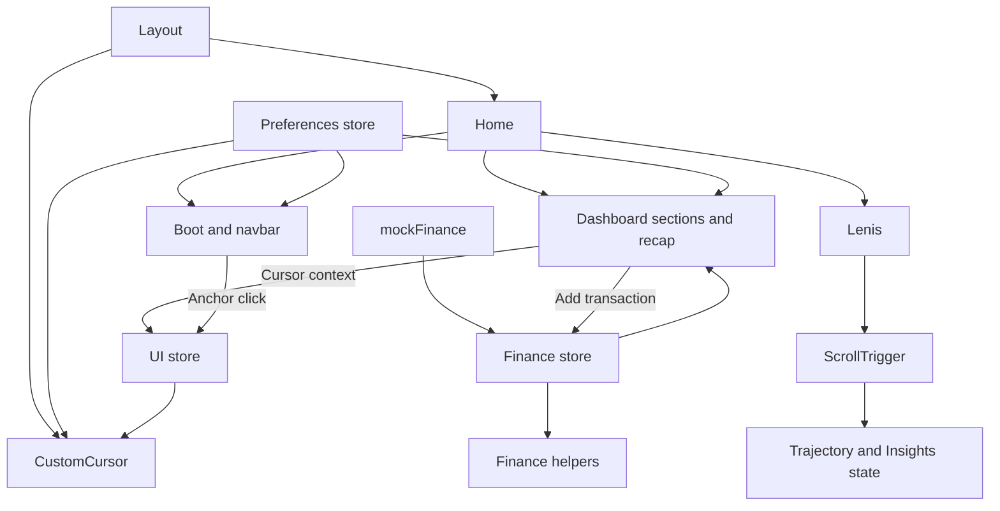

# Architecture

VEYRA is a single Next.js App Router page. [Root layout](../src/app/layout.tsx) configures fonts, metadata, the dark body and the global cursor. [Home](../src/app/page.tsx) composes the boot overlay, navbar, ordered page sections and recap modal, and owns the two booleans for boot completion and recap visibility.

| Module | Responsibility and data flow |
| --- | --- |
| `cinematic/BootSequence` | Local step and completion state. Timers advance authored text and call Home's completion callback. |
| `nav/Navbar` | Anchor navigation, clock and scroll styling, preference toggle, recap launcher. Active anchor is updated on link clicks. |
| `hero/CinematicHero` | Store income and finance getters supply figures at render. A Canvas 2D frame loop handles pointer illumination and particles. |
| `story/ScrollStory` | Income and finance getters supply four trajectory steps. The active step and pager are local. Benchmark and captions are authored. |
| `universe/SpendingUniverse` | Subscribes to transactions and budgets, calculates category spend and details at render, and uses fixed layout coordinates, trend and peak-day values. Hover updates shared cursor context. |
| `score/VeyraScore` | Reads health and savings-rate getters at render, reveals an animated count on entering the viewport and tracks the expanded signal locally. |
| `flow/CashFlowRiver` | Subscribes to income. Branch amounts and details are inline fixtures, with local expansion state. The separate `MOCK_CASH_FLOW_EVENTS` export does not drive the river. |
| `insights/VeyraInsights` | Local card index and static copy/evidence. There is no finance-store subscription. |
| `dashboard/BasicDashboard` | Subscribes to income, transactions and budgets. Getters provide the macro values, usage and health. Local state handles filters, hover, scrubber and the add form. Submission writes to the finance store. |
| `story/VeyraStoryModal` | Reads income, budgets and finance getters. Mixes computed slides with authored comparisons and owns its slide index, which stays mounted when closed. |
| `cursor/CustomCursor` and `ui/*` | Pointer visuals, shared button, metric, typography, panel, tooltip and section primitives. Framer Motion drives cursor and component-level transitions where used. |

[Finance store](../src/store/finance.ts) starts from the seed, updates the ledger and cached budget spend together for additions/deletions, and invokes [finance helpers](../src/lib/finance/index.ts) on getter calls. The getter functions have stable identities. A component subscribed only to income and getter references, or just to getter references, need not rerender on a transaction-only change. Hero, Trajectory and Score use this pattern. Universe and Command subscribe to actual changed data, and Recap subscribes to budgets.

Home initializes Lenis once on mount. Lenis reports scroll events to ScrollTrigger and advances via the GSAP ticker. Trajectory and Insights register pinned ScrollTriggers in GSAP contexts with `0.6` scrub and ranges of `+=300%` and `+=260%` respectively. Each maps progress to a local index and reverts its context on effect cleanup. Direct pager selection does not reposition scroll. Home destroys Lenis during cleanup. The initializer does not explicitly remove its ticker callback.

Finance, preferences and shared UI use in-memory Zustand stores. Component interactions use local React state. There is no localStorage, database or server-side user state in the application source. Reload restores the seed and default preferences.
